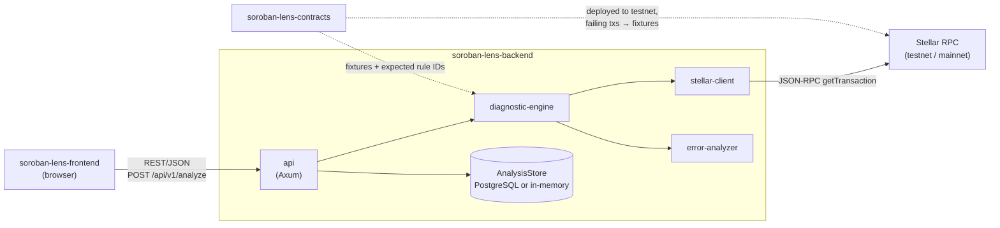

# SorobanLens architecture

SorobanLens helps developers understand failed Soroban smart contract
transactions. It is split across three repositories in one organization:

| Repository | Stack | Role |
|------------|-------|------|
| `soroban-lens-frontend` | React, TypeScript, Vite, Tailwind | Developer dashboard: submit hashes, view reports |
| `soroban-lens-backend` (this repo) | Rust, Axum, Tokio | REST API, Stellar RPC client, diagnostic engine |
| `soroban-lens-contracts` | Rust, Soroban SDK | Example contracts with intentional, reproducible failures; fixtures for backend tests |



## Integration points

### Frontend → backend

* REST over HTTP, JSON bodies, contract documented in [API.md](API.md).
* The frontend should mirror the types in `crates/models` (the single source of
  truth for the report schema). `metadata.schema_version` lets clients detect
  incompatible changes.
* CORS: the backend allows `http://localhost:5173` (Vite's default dev port)
  by default; production origins are set via `SOROBAN_LENS_CORS_ORIGINS`.
* Dashboard statistics come from `GET /api/v1/stats` and describe only the
  analyses served by that backend instance. They must not be shown as
  network-wide numbers.
* `issues[].details.event_message` comes from on-chain data and must be
  rendered as plain text.

### Backend → Stellar RPC

* JSON-RPC 2.0, method `getTransaction` (verified against the official
  reference). One endpoint per network, configured by environment variables.
* XDR is decoded with the official `stellar-xdr` crate (v30.0.0, which covers
  protocol 30, the current testnet protocol at time of writing).
* Diagnostic events are read from `diagnosticEventsXdr` or, when absent, from
  `TransactionMeta` V3/V4. Their availability depends on the RPC operator and
  is reported in every report.

### Contracts → backend

The contracts repository provides (planned for the next milestone):

1. Contracts that fail on purpose (missing `require_auth`, invalid input
   returning a `#[contracterror]`, predictable panics).
2. Scripts that deploy them to testnet and submit failing invocations.
3. The resulting `getTransaction` responses, committed as fixtures here under
   `crates/diagnostic-engine/tests/fixtures/`, each with the **expected rule
   ID and category**. That expectation table is the cross-repo test contract.

Until then, backend fixtures are real third-party testnet transactions (see
`crates/diagnostic-engine/tests/fixtures/README.md`).

## Shared terminology

All three repositories use these terms with these meanings:

| Term | Meaning |
|------|---------|
| **Analysis** | One run of the engine over one transaction; has an `id` |
| **Diagnostic report** | The output of an analysis (`DiagnosticReport`) |
| **Issue** | One diagnosed problem in a report (`DiagnosticIssue`) |
| **Rule ID** | Stable identifier of the rule that produced an issue, e.g. `invoke.trapped` |
| **Category** | Broad class of problem; values listed in [API.md](API.md#enumerations) |
| **Evidence level** | `confirmed`, `likely`, `possible`, `insufficient` |
| **Limitation** | Something the engine could not determine, and why |
| **Transaction status** | What the network says: `success`, `failed`, `not_found` |
| **Analysis status** | How complete the analysis was: `completed`, `partial`, `transaction_not_found` |

## Backend internals

```
soroban-lens-backend/
├── api/                      # Axum server (binary + library for tests)
│   ├── migrations/           # PostgreSQL schema (embedded, applied at startup)
│   └── src/
│       ├── config.rs         # env configuration and validation
│       ├── error.rs          # ApiError → JSON error responses
│       ├── rate_limit.rs     # per-IP fixed-window limiter
│       ├── routes.rs         # handlers
│       ├── store.rs          # AnalysisStore trait + in-memory impl
│       ├── store/postgres.rs # PostgreSQL impl (report as JSONB + indexed columns)
│       └── lib.rs            # router + middleware assembly
└── crates/
    ├── models/               # serialization-stable shared types
    ├── stellar-client/       # JSON-RPC client, TransactionSource trait
    ├── error-analyzer/       # Signals → DiagnosticIssues (rules, no I/O)
    └── diagnostic-engine/    # XDR decoding + orchestration
```

Dependency direction (no cycles):

```
api ──► diagnostic-engine ──► error-analyzer ──► models
                 └──────────► stellar-client ──► models
```

### Request flow for `POST /api/v1/analyze`

1. Middleware: request ID, tracing, timeout, CORS, body-size limit, rate limit.
2. Handler validates the hash and network.
3. `DiagnosticEngine::analyze` calls `TransactionSource::get_transaction`.
4. `extract` decodes envelope, result, and diagnostic events into `Signal`s,
   recording a `Limitation` for anything missing or undecodable.
5. `ErrorAnalyzer` runs each rule, orders findings, and adds limitations.
6. The report is stored and returned with `201 Created`.

### Design decisions

* **Analyzer independent of XDR.** Rules consume plain `Signal` values, so they
  are unit-testable and can be fed by other extractors later (e.g. simulation).
* **Decoding never aborts.** Untrusted XDR is decoded with depth/size limits;
  failures degrade to `partial` reports instead of errors.
* **Honest evidence.** Every issue states its evidence level and sources.
  Possible causes are never presented as confirmed.
* **Persistence behind a trait.** `AnalysisStore` has PostgreSQL and in-memory
  implementations, selected by `DATABASE_URL`; handlers don't know which is in
  use. Reports are stored whole as JSONB, so schema changes to the report don't
  need a migration; only indexed columns do.
* **No AI dependency.** Analysis is rule-based in this milestone.

## Security model

* Input validation on every field; unknown JSON fields rejected.
* Body size limit, request timeout, per-IP rate limit on the RPC-backed route.
* RPC URLs (which may embed provider keys) are never logged or returned; only
  the host is used in messages.
* Upstream and internal errors are logged server-side and mapped to generic
  client messages.
* `X-Content-Type-Options: nosniff` on all responses.
* `unsafe_code = "forbid"` across the workspace.

Known gaps are listed in the README under *Current status*.
